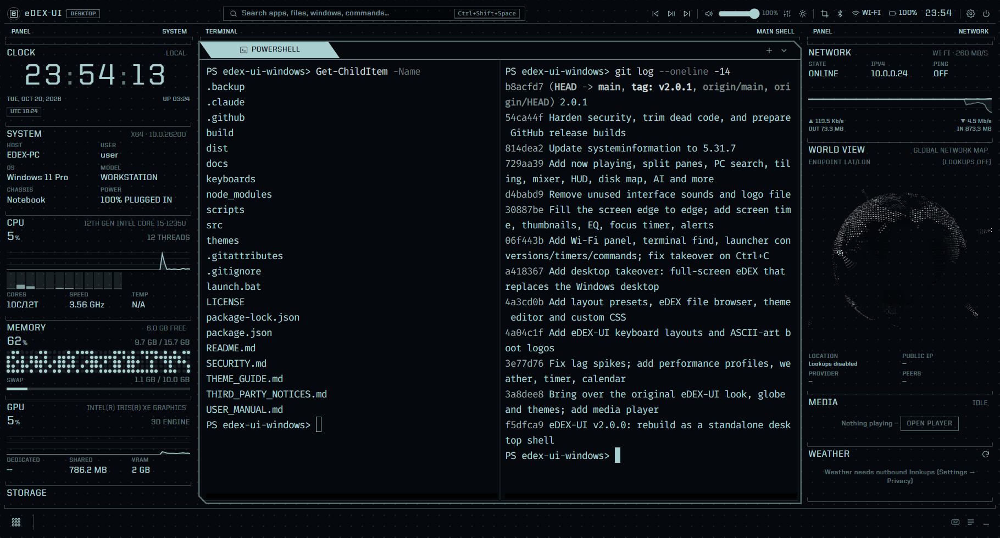
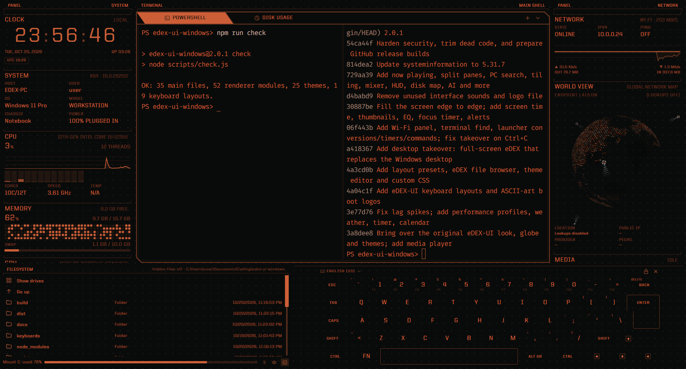
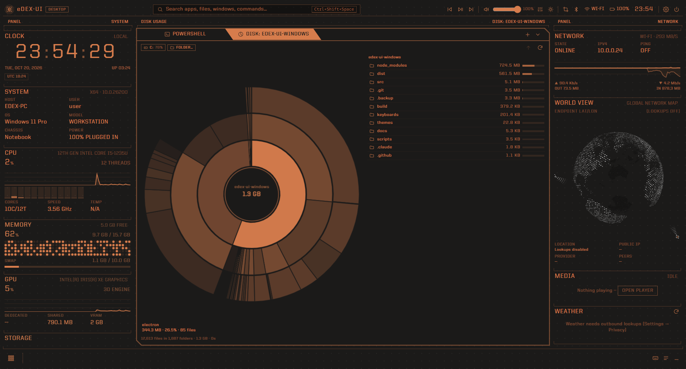
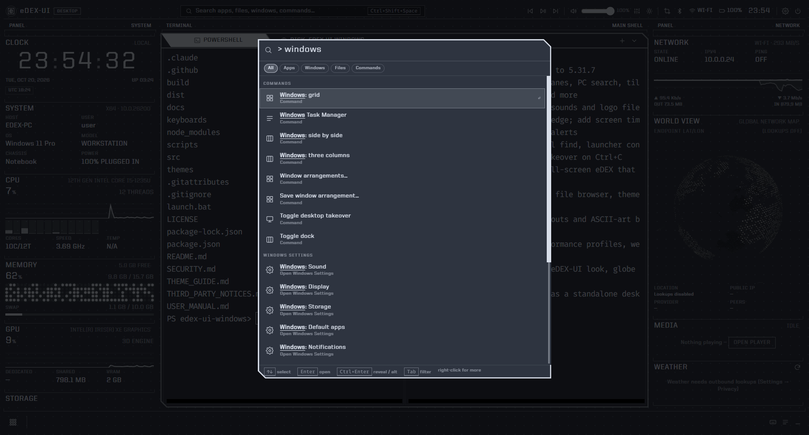

<p align="center">
  <br>
  <picture>
    <source media="(prefers-color-scheme: dark)" srcset="media/logo-dark.svg">
    
  </picture>
  <br><br>
  <a href="https://github.com/Lalabushi6/edex-ui-windows/actions/workflows/build.yml"></a>
  <a href="https://github.com/Lalabushi6/edex-ui-windows/releases/latest"></a>
  <a href="https://github.com/Lalabushi6/edex-ui-windows/releases"></a>
  <a href="LICENSE"></a>
  <br>
  
  
  
  <br>
  <a href="https://github.com/Lalabushi6/edex-ui-windows/releases/latest/download/eDEX-UI-Setup.exe"></a>
  <a href="https://github.com/Lalabushi6/edex-ui-windows/releases/latest/download/eDEX-UI-Portable.exe"></a>
  <br>
  <a href="https://github.com/GitSquared/edex-ui"><strong><i>(A Windows desktop-shell rebuild of GitSquared's eDEX-UI, archived Oct. 18th 2021)</i></strong></a>
  <br><br><br>
</p>

**eDEX-UI Windows Edition** is a fullscreen, sci-fi **desktop shell for Windows**:
a launcher, a window dock, tabbed terminals with split panes, browser tabs,
your app windows as tabs, a file explorer, a media player with Spotify and
live system telemetry, all on one surface in the style of
[eDEX-UI](https://github.com/GitSquared/edex-ui). You launch apps, switch
windows, browse and open files, play media, run terminals and watch your system
without ever dropping back to the Windows desktop. It can even **take over the
desktop** completely, hiding the taskbar while it's on screen.

It keeps everything that made the original special: the grid backdrop, the
"PANEL / SYSTEM" captions, the kernel-log boot sequence, the ENCOM globe, the
on-screen keyboard, the sound design and all the themes. Like the original, it's
heavily inspired by the *TRON Legacy* movie effects and Seena's
[DEX-UI](https://github.com/seenaburns/dex-ui). On top of that it's rebuilt from
scratch as something you can use every day on Windows, light on resources and
locked down.

<p align="center">
  
</p>

<p align="center">
  <em>Jump to: <br>
    <a href="#features">Features</a>
    — <a href="#screenshots">Screenshots</a>
    — <a href="#keyboard-shortcuts">Keyboard shortcuts</a>
    — <a href="#questions--answers">Questions &amp; Answers</a>
    — <a href="#download">Download</a>
    — <a href="#useful-commands-for-the-nerds">Commands for the nerds</a>
    — <a href="#security-model">Security</a>
    — <a href="#credits">Credits</a>
  </em>
</p>

## Features

### A desktop shell, not just a terminal
- **Two modes.** *Desktop*: full screen and sitting *behind* your apps, so it
  acts as your desktop; launch an app and it opens on top, close it and you're
  back in eDEX. *Overlay*: an always-on-top HUD you summon and dismiss with the
  global hotkey (`` Ctrl+` ``); it can hide itself when it loses focus or after
  launching something.
- **Desktop takeover.** eDEX fills the whole screen edge to edge (square
  corners, no border, exact physical pixels at any display scaling) and stands
  in for the Windows desktop. In Desktop mode the Windows taskbar is hidden
  while eDEX is showing and set to auto-hide, so maximised apps use the full
  screen; eDEX's dock lists your windows instead. *Show desktop* (Win+D) and
  *Minimise all* bring you back to eDEX. The taskbar is always restored when you
  hide eDEX, turn takeover off or quit, even after a crash or Ctrl+C in the
  console that started it. A dock button shows the taskbar for 15 seconds
  whenever you need the tray icons.
- **Launcher** (`Ctrl+Shift+Space`, works from any app): installed apps (Start
  menu, Store apps, desktop shortcuts), open windows, recent and indexed files,
  commands, themes, Windows Settings pages, plus:

  | Type | Result |
  |---|---|
  | an app / window / file name | Start-menu apps, Store apps, desktop shortcuts, open windows, recent files and your user folders |
  | any name | **On this PC**: matches anywhere the Windows Search index covers |
  | `"budget 2026"` (in quotes) | **Inside files**: documents containing those words |
  | `>` then text | commands (new tab, settings, themes, layouts, power, media …) |
  | `=2*(3+4)^2` | calculator (Enter copies the result) |
  | `10 km to mi`, `72 f in c`, `5 gb to mib`, `90 kmh to mph` | unit conversion: length, mass, volume, area, speed, time, data, energy, power, temperature |
  | `timer 5m tea`, `remind 1h30m stretch`, `stopwatch` | starts the Timer widget's countdown (alarm + Windows notification) or stopwatch |
  | `pomodoro`, `focus` | starts a focus session |
  | `$ ipconfig /all` | runs the command in the active terminal (or a new one) |
  | `? how do I find large files` | asks Claude (optional AI assistant) |
  | `C:\Users\` | browse paths; Tab completes the highlighted folder |
  | `google.com` | opens in your browser, or in an eDEX browser tab |
  | anything else | web search (engine set in Settings) |

  `Enter` opens, `Ctrl+Enter` reveals the file location (or closes a window),
  `Tab` cycles the All / Apps / Windows / Files / Commands filters, right-click
  a result to pin it to the dock, run as administrator or open its location.
  Frequently used results rank higher.
- **Dock**: an apps button, pinned apps, and every open window (click to
  switch, click the active one to minimise, middle-click to close,
  right-click to maximise, close or **snap**: left/right half, or **Snap
  layouts…** with halves, quarters, thirds, two-thirds, centre and maximise on
  the monitor the window is on).
- **Window arrangements**: lay out the front-most visible windows *side by
  side*, in *three columns* or a *grid*, or **save an arrangement** that
  remembers where every window is. Restoring it moves each window back, starts
  programs that aren't running and re-minimises the ones that were minimised.
- **App tabs**: any open window can live in a workspace tab (right-click it
  in the dock or launcher → *Show as a tab in eDEX*, the tab menu → *App
  window…*, or let **every open window get a tab** automatically). The tab
  moves the real window into its area and brings it forward; switching tabs
  minimises it, the tab keeps a picture of it while eDEX is in front, and
  closing the tab or quitting eDEX puts the window back where it was. Nothing
  is injected into the app. Turn on **Open apps inside eDEX** and every app
  you open from then on, from anywhere, opens straight into a tab.
- **Workspaces**: named setups such as *Work*, *Gaming* or *Study*, switched
  from the top bar, the launcher, a hotkey of their own or automatically at a
  time of day. Each has its own tabs (the others keep running in the
  background) and can bring back a theme, a layout and where your app windows
  were.
- **Notification centre**: the bell in the top bar keeps every eDEX reminder,
  alert, download, timer and update notice for two weeks, with **Do not
  disturb** to silence pop-ups, sounds and Windows notifications (critical
  battery warnings still show).
- **Multi-monitor HUD**: every display except the main one shows eDEX's
  telemetry panels, the globe and a large clock. It sits behind your windows
  on that display like a desktop does, and hides and returns with eDEX.
- **Screen saver mode**: after the minutes you choose without any input
  anywhere, eDEX covers every display with its effect (matrix rain, hex grid,
  starfield, globe or your ASCII wallpaper), above every app, even while it's
  hidden in the tray. Any input ends it; it can lock Windows as it ends, and
  it holds back during full-screen apps and video.
- **Live wallpaper**: while eDEX is hidden, its matrix rain, hex grid,
  starfield, globe, ASCII art or telemetry panels keep running as the actual
  Windows desktop background, behind your desktop icons. It pauses where a
  maximised window covers it, on battery and during games.
- Tray icon, single instance, start with Windows (straight onto the screen
  when it has taken over the desktop), session restore of tabs and split
  panes, close-to-tray.

### Web
- **Browser tabs** (`Ctrl+Shift+B`): real web pages in the workspace, with an
  eDEX toolbar (back / forward / reload, an address bar that also searches,
  zoom, find in page, open in your browser), favicons and page titles on the
  tabs, pop-ups as new tabs, downloads through a Save dialog, and tabs
  restored next time. Pages run in their own sandboxed session, separate from
  your usual browser and from eDEX itself; camera, microphone, location and
  notification requests are refused.
- Optionally, **web links open in eDEX**: from the launcher, quick links, the
  terminal and the explorer.

### Games
- **Game library** (`Ctrl+Shift+G`): your installed Steam, Epic Games and Xbox
  (PC Game Pass) games with their cover art, in a full-screen grid, in the
  launcher's *Games* filter and pinnable to the dock. Click to play; games
  start through their own launcher.
- **Game mode**: while a game runs (one from the library, or anything
  full-screen on Direct3D), eDEX goes quiet: animations and panel refreshes
  stop, the multi-monitor HUD hides, the screen saver and live wallpaper hold
  back, and notifications wait in the notification centre.

### Terminal
- **Tabs** for PowerShell, PowerShell 7, Command Prompt, WSL and Git Bash
  (whichever are installed), via `node-pty` and `xterm.js`, drawn on the GPU
  (WebGL) for fast output, with the terminal colours tinted to the theme.
- **Split panes**: up to four per tab (side by side, stacked, or 2 × 2), each
  with its own shell starting in the same folder. `Alt+Shift+=` / `Alt+Shift+-`
  (or `Ctrl+Shift+D`) split, `Alt`+arrows move between panes, `Ctrl+Shift+W`
  closes the focused pane. Input, find, the on-screen keyboard and the file
  browser follow the focused pane.
- **Find in terminal** (`Ctrl+Shift+F`, Enter / Shift+Enter, match case),
  clickable links (`Ctrl`+click), Windows Terminal-style copy / paste
  (right-click copies a selection or pastes), font zoom (`Ctrl+=` / `Ctrl+-` /
  `Ctrl+0`), restart a shell that exited with Enter, rename tabs.
- **Explain with Claude**: Shift+right-click → send the selection or the last
  screenful of output to the AI assistant.
- The shell's working directory is tracked (OSC 7 / OSC 9;9 or the prompt), so
  the file browser panel and the Git widget follow it.

### Files
- **File explorer tabs**: list and grid views (with **picture, video and PDF
  thumbnails** from Windows' own thumbnail cache), sorting, filter,
  breadcrumbs, type-a-path, copy / cut / paste, rename in place, drag files out
  to other apps or in from Windows Explorer (same drive moves, other drive
  copies; Ctrl / Shift to force), Recycle Bin deletes, pins, recents, "Open
  with…", "Open terminal here" and the Windows Properties sheet.
- **Quick-look viewer** (`Space`): images, audio, video, PDF and text, with
  in-place editing of text files (`Ctrl+S`), ← → to step through a folder.
- **eDEX file browser panel**: the original's filesystem panel, in the bottom
  strip beside the keyboard or under the panel columns, following the
  terminal's folder (and changing the shell's directory when it's at a
  prompt).
- **Whole-PC search** through the Windows Search index, by name or text inside
  documents, right in the launcher.
- **Disk usage map**: scan a drive or folder (on a background thread; a whole
  SSD takes seconds to a minute) and see a sunburst of what fills it: hover for
  size and share, click a ring to drill in, the centre to go back up, plus a
  list of the largest folders and files. Junctions and symlinks aren't
  followed, so nothing is counted twice.
- **Process manager**: name, PID, CPU, memory, threads and path, sortable and
  filterable; open a process's file location, copy its name or path, or end
  it (with confirmation; critical system processes are refused).

### System monitoring
- **Telemetry widgets**: clock with world clocks, system (host, OS, model,
  chassis, power), CPU (per-core load, speed, temperature where readable),
  memory and swap, GPU utilisation and memory, drives and disk I/O, top
  processes and network traffic.
- **World view**: the original ENCOM hex-tile globe with orbiting satellites,
  your location pin and connection arcs to reference cities (with latency);
  falls back to a canvas globe without WebGL.
- **Top bar**: what's playing, media keys, master volume with a **per-app
  volume mixer and output-device switch**, display brightness (laptop panels),
  screen snip, **Bluetooth** (radio on/off, paired devices and which are
  connected), network with a **Wi-Fi panel** (current connection, nearby
  networks, connect / disconnect), battery with **health** (capacity against
  design, charge cycles, chemistry), a clock with a month calendar and
  **events with reminders**, settings and a power menu (lock, sleep, sign out,
  restart, shut down).
- **Alerts**: low battery (and again at half that level) and low disk space,
  shown in eDEX and as Windows notifications while it's hidden.

### Media
- **Media player** (`Ctrl+Shift+M`): playlists with drag-to-reorder, shuffle
  and repeat, tags and cover art (MP3, FLAC, Ogg, M4A), video playback, a
  spectrum visualizer, resume where you left off, Windows media keys, and a
  "Now playing" widget.
  Playback continues when the tab is closed. Plays MP3, AAC/M4A, FLAC, WAV,
  Ogg/Opus, MP4 (H.264), WebM and most MKV files.
- **Music library**: your music folders by album, artist and song, with cover
  art (a `cover.jpg` / `folder.jpg` in the folder, or the art inside the
  files). Play an album, an artist or a song, or add them to the playlist.
- **Synced lyrics** (`L`): lyrics that scroll along with the song, for your
  files, Spotify and any app in *Now playing*, over the visualizer and as a
  widget. They come from the free [LRCLIB](https://lrclib.net) service, or from
  a `.lrc` file next to the song.
- **Internet radio**: thousands of stations from the community
  [Radio Browser](https://www.radio-browser.info) directory, by name or
  genre, plus favourites and stations added by URL (.pls and .m3u links
  work). A station is an entry in the playlist, so the visualizer, the
  equalizer and media keys work with it, and the station's *now playing* title
  shows as the track.
- **10-band equalizer** (32 Hz to 16 kHz, ±12 dB) with presets (Bass boost,
  Treble boost, Vocal, Rock, Electronic, Acoustic, Loudness, Late night) and
  your own curves; boosts are balanced so loud tracks don't distort.
- **Visualizer styles** (`V`): bars, mirrored bars, LED blocks, dots, a
  spectrum line, the waveform or a radial burst; 16–128 bands; the theme
  colour, a theme gradient, a rainbow or your own colour; peak caps,
  reflection, smoothing and sensitivity.
- **Spotify inside the player**: switch the player to *Spotify* to see what's
  playing (cover art, progress, device), browse your playlists, liked songs
  and recent tracks, search, pick the device it plays on, and control
  playback, shuffle, repeat and volume. Connects with a free Spotify developer
  app of your own (PKCE sign-in, nothing secret stored in plain text);
  without an account it still shows and controls the Spotify app on this PC.
- **System-wide Now playing**: whatever Spotify, a browser, VLC or any other
  app reports to Windows (title, artist, cover art, play / pause / skip and
  seek) in the Media widget and the top bar.

### Productivity tools
- **Tasks** with reminders written in plain words: `call mum at 6pm`,
  `report in 2h`, `dentist tomorrow 9:30`, `gym friday`. Reminders ring and
  notify even while eDEX is hidden; ones missed while it was closed show once
  at startup.
- **Calendar events** with optional reminders (at the time, 5 / 15 / 30 /
  60 minutes or a day before), marked on the calendar and listed in the Tasks
  widget on the day.
- **Calendar subscriptions**: paste a Google, Outlook or iCloud calendar's
  secret iCal (.ics) link and its events show on the calendar and in the
  Tasks widget, in their own colour, with optional reminders. Repeating
  events, time zones and all-day events are handled; feeds refresh every
  half hour and are kept for offline use.
- **Timer, stopwatch (with laps) and a pomodoro focus timer** (25 / 5 / 15
  minutes, configurable; breaks start on their own). A finished countdown
  plays the alarm and shows a Windows notification, even while eDEX is
  hidden.
- **Screen time**: how long each program has been the focused window today and
  over the past week, with optional daily limits that nudge you once a day.
  Kept on this PC only, for two weeks.
- **Git widget**: branch, commits to push / pull, staged / changed / new file
  counts, the last commit and the changed files for the terminal's folder.
- **Command widgets**: any PowerShell or cmd command's output as a panel,
  refreshed on a schedule (disk space, uptime, a status API, `git log` …).
- **AI assistant** (optional, your own Anthropic API key): ask Claude from the
  launcher (`? question`), with `Ctrl+Shift+J`, or "Explain with Claude" on
  terminal output. Answers stream in; commands in them run in the terminal
  with one click. Choose Claude Opus 5.5, Sonnet 5.5 or Haiku 5.5.
- **Weather** with a four-day forecast, **notes** (auto-saved), **clipboard
  history** (memory only, never written to disk) and **quick links**.

### Look and feel
- **The eDEX-UI look**: the original's grid backdrop, "PANEL / SYSTEM"
  captions, ruled modules, slanted shell tabs, clipped-corner frames, logo,
  kernel-log boot sequence with the glitching title, and sound effects.
- **25 themes** from the original (with their globe colours and colour
  filters): Apollo, Blade, Chalkboard, Cyberpunk Red, Cyborg, Default,
  Interstellar, Matrix, Navy, Nord, Red, Tron, Worldview v2 and their
  *disrupted / notype / typeleft / fulltype / focus / ligatures / colorfilter*
  variants, plus the bundled **Ember** theme for the classic orange look.
- **Theme editor** with live preview (every colour, interface and terminal
  fonts, terminal palette, globe, layout hints, theme CSS), import / export of
  eDEX-UI theme files, and a **custom CSS** stylesheet with documented hooks
  (see [THEME_GUIDE.md](THEME_GUIDE.md)).
- **Layout presets**: *Shell* (top bar, dock, both columns), *Original
  eDEX-UI* (no top bar or dock; file browser and keyboard along the bottom),
  *Keyboard left*, *Panels left / right* and *Focus*. Every region can be shown,
  hidden or moved, both panel columns can sit on one side, widgets drag to
  reorder.
- **On-screen keyboard** with all 19 eDEX-UI layouts: English (US, UK,
  Dvorak, Colemak, Workman, Norman), French (AZERTY, BÉPO), German, Spanish
  (Spain, Latin America), Italian, Portuguese (Brazil), Dutch (Belgium),
  Danish, Swedish, Hungarian and Turkish (F, Q), plus your own custom layouts:
  Shift / Caps / Ctrl / AltGr / Fn layers, dead keys for accents, password
  mode. It types into the terminal, any text field, or triggers app shortcuts.
- **Boot logo**: your own title or ASCII art (pasted, loaded from .txt / .nfo /
  .ans, or generated as block letters), scaled to fit the screen.
- **ASCII wallpaper**: your ASCII art as a workspace pane instead of a
  terminal, huge and in the theme colour, with a scanline, glitch, typing or
  pulse animation, a clock and an ambient effect behind it. It can also take
  the terminal's place while you're away (idle pane) and be the idle-screen
  or screen-saver effect.
- **Idle screen and animated backgrounds**: matrix rain, hex grid, starfield,
  globe or the ASCII wallpaper, in the theme colour.
- Interface scaling, 12 / 24-hour clock, Celsius / Fahrenheit.

### Light on resources
- System readings come from **one long-lived native helper** (no process
  launches while running); a second helper handles slow calls (media
  sessions, Bluetooth, search, disk scans) so the panels never wait.
- Every panel refreshes from **one shared scheduler**, and **nothing runs while
  eDEX is hidden**, minimised or covered.
- **Performance profiles** (Auto / Performance / Balanced / Eco; Auto switches
  to Eco on battery or battery saver) set refresh rates and animation frame
  rates; Settings → Performance shows eDEX's own CPU and memory use.

### Settings, updates and portable use
- **Settings backup**: export / import every setting, your custom themes and
  keyboard layouts as one file, to keep or move to another PC. Importing a
  file that contains command widgets asks before allowing them.
- **Updates from GitHub**: eDEX checks this repository's releases (once a
  day, or on demand), shows the release notes, and downloads and installs the
  new version — the installer for an installed copy, the new `.exe` for the
  portable one — after checking it against GitHub's SHA-256 digest.
- **Portable on a USB drive**: the portable `.exe` keeps all its data
  (settings, notes, tasks, themes, sign-ins) in an `eDEX-UI Data` folder next
  to itself, so your eDEX travels with the drive; on a PC that has eDEX
  installed it offers to copy that setup over.

## Screenshots


<p align="center"><i>Tron theme (default): a terminal split in two between the system panels (clock, CPU, memory, GPU) and the network, world view, media and weather panels.</i></p>



<p align="center"><i>The "Original eDEX-UI" layout preset in the Blade theme: no top bar or dock, the file browser and on-screen keyboard along the bottom.</i></p>



<p align="center"><i>The disk usage map in the Ember theme: drill into what's filling a drive.</i></p>



<p align="center"><i>The launcher in command mode (Nord theme): apps, windows, files, commands, settings, conversions and more from one box.</i></p>

## Keyboard shortcuts

| Keys | Action |
|---|---|
| `Ctrl+Shift+Space` | Launcher (works from any app) |
| `` Ctrl+` `` | Show / hide eDEX (works from any app) |
| `Ctrl+Shift+P` | Command palette |
| `Ctrl+Shift+A` | Switch window |
| `Ctrl+Shift+T` / `Ctrl+Shift+E` | New terminal / explorer tab |
| `Ctrl+Shift+B` | New browser tab (in it: `Ctrl+L` address, `Ctrl+F` find, `Ctrl+T` / `Ctrl+W` new / close, `F5` reload, `Alt+←/→` back / forward) |
| `Ctrl+Shift+W` | Close tab (or the focused split pane) |
| `Ctrl+Tab`, `Ctrl+1…9` | Switch tabs |
| `Alt+Shift+=` / `Alt+Shift+-` / `Ctrl+Shift+D` | Split the terminal right / down |
| `Alt`+arrows | Move between split panes |
| `Ctrl+Shift+F` | Find in terminal (or find files outside a terminal) |
| `Ctrl+Shift+K` | On-screen keyboard |
| `Ctrl+Shift+M` | Media player (in it: `E` equalizer, `V` visualizer, `L` lyrics) |
| `Ctrl+Shift+G` | Game library |
| `Ctrl+Shift+J` | Ask Claude (AI assistant) |
| `Ctrl+Shift+S` | Export a system snapshot (JSON, saved to Documents) |
| `Ctrl+,` | Settings |
| `F1` | Shortcut sheet |

The two global hotkeys can be changed in Settings → General, and each
workspace can have a global hotkey of its own (Settings → Workspaces). The
full list,
including the explorer, media player and keyboard keys, is in
[USER_MANUAL.md](USER_MANUAL.md).

## Questions & Answers

#### How do I get it?
Download the installer or the portable `.exe` from the
[Releases](https://github.com/Lalabushi6/edex-ui-windows/releases/latest) page
(see [Download](#download) below), or build it yourself from source
([Useful commands for the nerds](#useful-commands-for-the-nerds)).

#### Can I use it as my actual desktop?
Yes, that's the point. Settings → General → **Take over the desktop** (also in
the tray menu and the launcher) makes eDEX fill the whole display and hide the
Windows taskbar while it's on screen. Turn on **Start with Windows** and it
opens straight onto the screen at sign-in. Your taskbar always comes back when
you hide eDEX (`` Ctrl+` ``), turn takeover off or quit.

#### The taskbar stayed hidden after eDEX crashed. What do I do?
Start eDEX again: it notices and puts the taskbar back. (eDEX's helper process
also restores it when eDEX dies, so this should be rare.)

#### Windows SmartScreen says the app is unrecognised.
The executables aren't code-signed (that needs a paid certificate), so
SmartScreen warns the first time. Click **More info → Run anyway**. The builds
are made in the open by GitHub Actions from this repository's source.

#### Can you disable the keyboard / the file browser / the top bar?
Yes. Settings → Layout shows, hides or moves every region (top bar, dock, both
panel columns, on-screen keyboard, file browser) and every widget, or pick a
preset. `Ctrl+Shift+K` toggles the keyboard. With the top bar and dock hidden,
`Ctrl+Shift+Space` still opens the launcher and `Ctrl+,` the settings.

#### How do I switch themes and layouts?
Settings → Appearance for themes (or type `>theme` in the launcher), Settings →
Layout for layout presets (or `>layout`). Some of the original's themes
(*disrupted*, *notype*, *typeleft*, *fulltype*) also move panels around; turn
that off with "Themes can change the layout".

#### Can I browse the web inside eDEX?
Yes: `Ctrl+Shift+B` (or the tab menu → Browser) opens a browser tab with an
address bar that also searches, back / forward, zoom, find in page and pop-ups
as new tabs. Pages run in their own sandboxed session with separate sign-ins.
Turn on Settings → Web & apps → **Open web links in eDEX** to send links from
the launcher, quick links, the terminal and the explorer there too. A few
sites (Google sign-in, for one) refuse embedded browsers; the ↗ button opens
the page in your usual browser.

#### Can my apps live inside eDEX?
As tabs, yes. Right-click a window in the dock or launcher → **Show as a tab
in eDEX**, or turn on **Show every open window as a tab** (Settings → Web &
apps). The tab moves the app's real window into the workspace and brings it
forward; switching tabs minimises it, and closing the tab or quitting eDEX
puts it back where it was. eDEX doesn't inject anything into the app, so a
misbehaving app can't freeze eDEX. **Open apps inside eDEX** (same page) goes
further: every app you open from then on, from eDEX, the Start menu or
anywhere else, opens straight into a tab (games are left alone).

#### Can eDEX be my desktop wallpaper?
Yes: Settings → Appearance → **Live wallpaper**. Whenever eDEX is hidden, the
effect you pick (matrix rain, hex grid, starfield, globe, your ASCII art or
the telemetry panels) runs as the Windows desktop background, behind your
icons, which stay clickable. It goes away while eDEX is on screen, and pauses
where a maximised window covers it, on battery and during games. Turn it off
and your normal wallpaper is back.

#### Can eDEX keep out of the way while I game?
That's game mode. When a game from the library (Steam, Epic or Xbox), or
anything else running full screen on Direct3D, is in front, eDEX stops its
animations and refreshes, hides the HUD on other displays, holds the screen
saver and live wallpaper back and keeps notifications in the bell instead of
popping them up. Settings → Games can also turn it on by hand or off
altogether.

#### Can I see my Google or Outlook calendar?
Yes, read-only. Copy the calendar's secret iCal address (Google Calendar:
calendar settings → *Integrate calendar* → *Secret address in iCal format*;
Outlook: Settings → Calendar → *Shared calendars* → *Publish a calendar* →
ICS link), then paste it in Settings → Calendar. Treat that link like a
password: anyone with it can read the calendar.

#### Does it work with Spotify?
Two ways. Without any setup, the media player's *Spotify* view (and the Now
playing widget) shows and controls whatever the Spotify app on this PC is
playing. Connect your account (a free Spotify developer app of your own,
about two minutes — the steps are in the view and in
[USER_MANUAL.md](USER_MANUAL.md)) to also browse playlists, liked songs and
recent tracks, search, and choose which device plays. Spotify itself plays
the music; its rules require Premium for playback control. eDEX-UI isn't
affiliated with Spotify.

#### Can I run it from a USB stick?
Yes, use `eDEX-UI-Portable.exe`. It keeps everything (settings, notes, tasks,
themes, sign-ins) in an `eDEX-UI Data` folder next to itself, so your setup
moves with the drive. The AI key and Spotify sign-in are encrypted with the
Windows account that saved them, so on another PC you enter them again.

#### How do I update?
Settings → About → **Check now** (eDEX also checks once a day while outbound
lookups are on). If there's a new release it shows the notes; **Download and
install** fetches it from GitHub, checks its SHA-256, and runs the installer
(or replaces the portable `.exe`) after you confirm. Your settings are kept.

#### Does it send anything over the internet?
Only if you let it. With **Outbound lookups** on (the default), the world-view
globe looks up your approximate location from your public IP and checks
latency to a few public sites, the weather widget fetches a forecast, eDEX
checks GitHub for a new release once a day, lyrics are looked up on LRCLIB
(the song's title, artist, album and length), game cover art missing from your
launchers' caches is fetched from Steam's and Epic's image servers, the radio
view lists popular stations from Radio Browser, and calendar subscriptions
refresh every half hour. Turn it off under Settings → Privacy and eDEX makes
no outbound requests of its own. Pages you open in browser tabs, radio
stations you play or search for, calendar *Refresh*, Spotify (once you connect
it) and the AI assistant (off until you add your own API key) only go online
when you use them. Whole-PC search, the disk map, Bluetooth, Now playing, the
mixer, the music library and app tabs work locally through Windows. See
[Security model](#security-model).

#### What does the AI assistant cost, and is my key safe?
It uses your own Anthropic API key (console.anthropic.com), billed to your
API account. The key is encrypted with your Windows account (DPAPI), never
shown again, and only sent to Anthropic's API (api.anthropic.com) when you
ask something. Pick Claude Opus 5.5 for the best answers, or Sonnet 5.5 /
Haiku 5.5 for faster, cheaper ones. If Opus or Sonnet declines a
request, the API retries it on a fallback model automatically. Commands in
answers only run when you click **Run in terminal**.

#### How heavy is it on my PC?
Light for what it shows: telemetry comes from one long-lived helper, every
panel shares one refresh timer, and nothing refreshes or animates while eDEX is
hidden, minimised or covered. On battery the Auto profile switches to Eco.
Settings → Performance shows eDEX's own CPU and memory use per process. The
download is about 100 MB (most of it is the Electron runtime).

#### Where are my settings? Can I move them to another PC?
In `%APPDATA%\eDEX-UI` (settings, notes, tasks, themes, keyboard layouts,
screen time, browser-tab sign-ins), or, for the portable `.exe`, in
`eDEX-UI Data` next to it; Settings → About shows which and opens it.
Settings → About → **Back up settings** exports everything to one file and
imports it elsewhere. Settings from the original eDEX-UI
(`%USERPROFILE%\.edex-ui-settings.json`) are imported on first run.

#### Does it run on Windows 10, ARM, macOS or Linux?
Windows 10 (version 1809 or newer) and Windows 11, 64-bit (x64); there's no
native ARM64 build. The shell
features talk to Windows directly (window management, the taskbar, Core Audio,
media sessions, Windows Search), so there's no macOS or Linux build; the
[original eDEX-UI](https://github.com/GitSquared/edex-ui) still runs there.

#### Is this the official eDEX-UI?
No. The original by GitSquared was archived on October 18th, 2021. This is an
independent rebuild for Windows that reuses its look, themes, keyboard layouts,
sounds and globe (GPL-3.0) and adds the desktop-shell features.

#### I have a problem!
Check the troubleshooting section of [USER_MANUAL.md](USER_MANUAL.md), then
open an issue with what happened and your Windows version. For security
problems, see [SECURITY.md](SECURITY.md) instead.

#### How did you make this?
Electron, xterm.js and node-pty for the terminals, plain ES modules for the
interface (no framework), and a long-lived PowerShell helper that compiles a
small C# library on first run to reach Win32, Core Audio, WinRT and Windows
Search without spawning processes. The globe is the original's ENCOM globe.

#### This is so cool.
Thanks! Most of the credit for the look goes to the original
[eDEX-UI](https://github.com/GitSquared/edex-ui).

## Download

Grab the latest build from the
[Releases](https://github.com/Lalabushi6/edex-ui-windows/releases/latest)
page:

| File | What it is |
|---|---|
| [`eDEX-UI-Setup.exe`](https://github.com/Lalabushi6/edex-ui-windows/releases/latest/download/eDEX-UI-Setup.exe) | Installer: per user, no admin rights, choose the folder, Start menu and desktop shortcuts, uninstaller (your settings are kept). |
| [`eDEX-UI-Portable.exe`](https://github.com/Lalabushi6/edex-ui-windows/releases/latest/download/eDEX-UI-Portable.exe) | A single file that runs without installing — from a USB drive too. Everything it remembers goes into an `eDEX-UI Data` folder next to it, so it travels with the drive. |

Requirements: Windows 10 (1809) or 11, 64-bit. The executables aren't
code-signed, so SmartScreen may warn the first time: **More info → Run
anyway**. Once installed, eDEX finds new releases itself (Settings → About →
Updates). Every push also produces test builds under the repository's
**Actions** tab (see [Getting the bleeding edge](#getting-the-bleeding-edge)).

Read [USER_MANUAL.md](USER_MANUAL.md) for everything eDEX can do, and
[THEME_GUIDE.md](THEME_GUIDE.md) to make your own themes.

## Useful commands for the nerds

**IMPORTANT NOTE:** You need [Node.js](https://nodejs.org) 20 or newer and Git.
No Developer Mode, admin rights or code-signing certificate is needed.

#### Starting from source:

```bash
git clone https://github.com/Lalabushi6/edex-ui-windows.git
```

```bash
cd edex-ui-windows
```

```bash
npm install
```

```bash
npm start
```

Or double-click [`launch.bat`](launch.bat), which runs `npm start` from the
project folder (handy for a desktop shortcut).

Environment variables for development:

| Variable | Effect |
|---|---|
| `EDEX_DEV_WINDOWED=1` | Run in a normal resizable window instead of full screen (what `npm run dev` sets); screen saver windows are windowed too |
| `EDEX_HUD_PREVIEW=1` | With `EDEX_DEV_WINDOWED=1` on a single-monitor PC, opens the multi-monitor HUD as a window so you can see it |
| `EDEX_PORTABLE_DIR=<folder>` | Behave like the portable build with its `.exe` in that folder (data goes to `<folder>\eDEX-UI Data`) |
| `EDEX_UPDATE_API=<url>`, `EDEX_UPDATE_KIND=installer` | Point the update check at a test server, and pretend to be an installed copy so downloads can be tried |
| `EDEX_SPOTIFY_ACCOUNTS=<url>`, `EDEX_SPOTIFY_API=<url>` | Point the Spotify sign-in and Web API at a test server |

These only work when running from source; packaged builds ignore them.

#### Building:

| Command | What it does |
|---|---|
| `npm start` | Run eDEX from source (full screen) |
| `npm run dev` | Run it in a resizable window |
| `npm run check` | Static checks (syntax, imports, themes, keyboard layouts) |
| `npm run dist` | Build the installer and portable `.exe` into `dist/` |
| `npm run dist:dir` | Build just the unpacked app (`dist/win-unpacked/eDEX-UI.exe`) |

How the build works:
- [electron-builder](https://www.electron.build) packages the app into
  `app.asar` and makes an NSIS installer (`eDEX-UI-Setup.exe`) and a portable
  executable (`eDEX-UI-Portable.exe`).
- The icon and version details are stamped onto `eDEX-UI.exe` by
  [`build/afterPack.js`](build/afterPack.js) with `rcedit`. electron-builder's
  own executable editing (`win.signAndEditExecutable`) is off because its
  helper bundle can't be unpacked without Windows Developer Mode.
- The packaged app is hardened with **Electron fuses**: no `--inspect`, no
  `NODE_OPTIONS`, code loads only from the app archive, cookies are encrypted.
  (`runAsNode` stays on because node-pty needs it.)
- Unneeded dependency files (sources, docs, tests, other platforms' binaries)
  are left out of the package.

#### Getting the bleeding edge:

**GitHub Actions** ([`.github/workflows/build.yml`](.github/workflows/build.yml))
builds both executables on every push and pull request. Open the
[Actions](https://github.com/Lalabushi6/edex-ui-windows/actions) tab → the
latest **Build** run → **Artifacts** → `eDEX-UI-windows` (kept for 90 days).

#### Releasing:

```bash
npm version patch
```

```bash
git push --follow-tags
```

Pushing a version tag (`v2.0.1`) makes the workflow publish a GitHub Release
with both executables and generated release notes. See
[docs/PUBLISHING.md](docs/PUBLISHING.md) for putting the project on GitHub,
cutting releases and fixing common problems.

#### Project layout:

```
src/main/            Electron main process
  main.js            lifecycle, single instance, hotkeys, IPC registration
  window.js          desktop / overlay window modes
  hud.js             multi-monitor HUD windows
  settings.js        typed settings schema, validation, v1 migration
  tray.js            tray icon and menu
  preload.js         the renderer's only bridge (window.edex)
  ipc/               terminal, system, files, desktop (apps/windows/media keys/power), media player,
                     audio mixer, now playing, Bluetooth, disk usage, window arrangements,
                     tools (command widgets, git, battery health, tasks, settings backup), AI,
                     browser tabs, app tabs, Spotify, updates, games, lyrics, radio, music
                     library, calendar feeds, extras
  lib/               protocols, path policy, cache, JSON store, telemetry, icon service,
                     takeover, screen time, alerts, notification centre, screen saver,
                     live wallpaper, game mode, portable mode, audio tags, iCalendar parser
  native/bridge.ps1  long-lived PowerShell helper for Win32 / Core Audio / WinRT / Windows Search;
                     a second instance handles slow calls (media sessions, Bluetooth, search, disk scans)
src/renderer/        UI (ES modules served from app://edex)
  js/core/           DOM builder, settings, theme, commands/hotkeys, scheduler,
                     shared telemetry feeds, UI kit, web links
  js/widgets/        side-column widgets (incl. tasks, git, command widgets)
  js/workspace/      tabs: terminal (split panes), explorer, process manager, media player (+ Spotify,
                     music library and radio views), disk usage, browser, app windows, ASCII wallpaper
  js/shell/          top bar, dock, launcher, settings, viewer, keyboard, boot, mixer, Bluetooth,
                     battery, now playing, window arrangements, agenda, AI panel, idle screen, effects,
                     wallpaper, updates, notification centre, games, workspaces
  js/media/          media player engine, visualizer, synced lyrics
  lib/encom-globe.js the ENCOM globe (from eDEX-UI)
themes/              built-in themes (JSON, eDEX-UI format)
keyboards/           on-screen keyboard layouts (JSON, eDEX-UI format)
build/               app icon and the afterPack hook (rcedit)
scripts/             check.js
media/               README logo and screenshots
docs/                PUBLISHING.md (GitHub and releases)
.github/workflows/   build.yml (installer + portable exe, releases)
```

#### Documentation:

| File | What's in it |
|---|---|
| [USER_MANUAL.md](USER_MANUAL.md) | Everything eDEX does: layout, modes, workspaces, launcher, dock, games, terminal, browser tabs, app tabs, explorer, media (Spotify, library, lyrics, radio), keyboard, wallpaper and live wallpaper, tools, notifications, calendar, screen saver, settings, privacy, updates and portable use, troubleshooting |
| [THEME_GUIDE.md](THEME_GUIDE.md) | Making and editing themes, custom CSS hooks |
| [docs/PUBLISHING.md](docs/PUBLISHING.md) | Putting the project on GitHub, automatic builds, releases |
| [SECURITY.md](SECURITY.md) | Reporting security problems, how eDEX is built to be safe |
| [THIRD_PARTY_NOTICES.md](THIRD_PARTY_NOTICES.md) | Credits and licences of included work |

## Security model

- **Renderer**: `contextIsolation`, `sandbox`, no Node integration, strict CSP
  (scripts only from the bundle), served from a custom `app://` origin.
  Navigation, new windows and `<webview>` are blocked, and so are downloads and
  web permission requests (camera, microphone, location, devices); only
  fullscreen is granted.
- **IPC**: every handler checks that the calling frame is the bundled UI and
  validates its arguments; settings are coerced against a typed schema.
- **Paths** are resolved through symlinks/junctions before any check.
  Credential stores and token files (`.ssh`, `.aws`, `.gnupg`, `.azure`,
  `.kube`, `.docker`, `.git-credentials`, `.npmrc`, `.netrc`, the GitHub CLI
  login, browser profiles, the Windows credential vault and DPAPI keys, eDEX's
  own encrypted API key …) are never readable. Writes are refused in Windows,
  Program Files, ProgramData, on drive roots and on network paths.
- **Deleting** moves items to the Recycle Bin.
- **Confirmations the UI can't fake**: running an executable from the explorer
  outside the Start menu / Desktop, ending a process and power actions are
  confirmed by the main process; critical system processes are refused
  outright. Importing a settings file that contains command widgets lists
  their commands and asks first.
- **Local files** reach the UI only through the read-only `localfile:`
  protocol (images and media), which refuses credential stores and anything
  that resolves to a network share; page scripts can't `fetch` them.
- **The Git widget** won't inspect a repository whose own config would make Git
  start programs (fsmonitor, clean/smudge filters, includes).
- **Browser tabs** are separate sandboxed views in their own session
  (`persist:edex-browser`) with no preload bridge, so pages can't call eDEX
  or reach `app://` / `localfile:`. Only `http(s)` loads, pop-ups become tabs,
  web permissions are refused (apart from fullscreen and clipboard writes),
  downloads go through a Save dialog, and the page steps aside behind a
  still picture whenever an eDEX menu or dialog is open.
- **App tabs** only move, minimise and restore another app's window (and
  picture it); nothing is injected or re-parented, and windows go back where
  they were when the tab closes or eDEX quits. *Open apps inside eDEX* only
  watches the window list for new top-level windows.
- **The live wallpaper** re-parents only eDEX's own wallpaper windows into
  Explorer's desktop layer (the documented-in-practice `Progman` / `WorkerW`
  arrangement every live-wallpaper app uses); they don't take focus or input,
  and are removed whenever eDEX shows, quits or the setting is turned off.
- **Internet radio** streams reach the interface only through the
  `edexradio:` protocol: the main process fetches the station (http/https
  only), resolves .pls / .m3u links and strips the stream's title metadata,
  so the interface's CSP stays closed to the internet. Station logos and game
  covers arrive as data / local files, never as remote images.
- **Calendar links** are kept in settings like your other preferences and
  only ever fetched; the downloaded copies live in `calendars/` in eDEX's data
  folder. Anyone with a secret iCal link can read that calendar, so treat
  settings backups that contain one accordingly.
- **Secrets** — the AI key and the Spotify refresh token — are encrypted with
  your Windows account (DPAPI) and unreadable through eDEX's own file
  previews. Spotify uses PKCE sign-in through a loopback address, so there's
  no client secret.
- **Updates** must match the size and SHA-256 digest GitHub publishes for the
  release file before anything runs, and installing always asks first.
- **Packaged builds** disable Node inspection and `NODE_OPTIONS` and load code
  only from the app archive (Electron fuses).

**Privacy:** the world-view globe looks up your public IP location (ipapi.co,
falling back to ipinfo.io) and checks latency to google.com and twelve public
sites; the weather widget fetches a forecast for that approximate location
from open-meteo.com; once a day eDEX asks api.github.com for the latest
release; lyrics are looked up on lrclib.net (title, artist, album and
length of what's playing); missing game covers come from Steam's
(steamstatic.com) and Epic's image servers; the radio view's popular list
comes from radio-browser.info; and calendar subscriptions refresh from the
links you added. Turn all of this off under Settings → Privacy. Browser
tabs, radio stations and station search, Spotify (accounts.spotify.com,
api.spotify.com and its cover-art servers) and the AI assistant only go
online when you use them. Clipboard history is never
written to disk. Screen time stores only program names and durations, on
this PC, for two weeks. The AI assistant is off until you add your own key
and sends only what you ask. Report problems as described in
[SECURITY.md](SECURITY.md).

## Credits

The look, themes, keyboard layouts, logo and icons, interface sounds, fonts,
boot log and globe come from [eDEX-UI](https://github.com/GitSquared/edex-ui)
by Gabriel "Squared" SAILLARD ([@GitSquared](https://github.com/GitSquared))
and contributors (GPL-3.0), whose sound effects were composed by IceWolf. The
globe is their fork of Rob Scanlon's
[ENCOM Globe](https://github.com/arscan/encom-globe) (MIT), bundled with
three.js r66, tween.js, quadtree2 and pusher's vec2 helpers (all MIT). The
fonts are United Sans (from eDEX-UI) and Fira Mono / Fira Code (SIL Open Font
License 1.1). See [THIRD_PARTY_NOTICES.md](THIRD_PARTY_NOTICES.md).

This Windows edition, its desktop-shell features and the rebuild are by
[Lalabushi6](https://github.com/Lalabushi6).

## Thanks

To [GitSquared](https://github.com/GitSquared) and everyone who worked on
eDEX-UI, which this project rebuilds for Windows, and to
[Seena](https://github.com/seenaburns), whose
[DEX-UI](https://github.com/seenaburns/dex-ui) (first shared on
[r/unixporn](https://reddit.com/r/unixporn)) inspired the original.

And to the open-source projects eDEX runs on (the full list is in
[package.json](package.json)):
[Electron](https://github.com/electron/electron),
[electron-builder](https://github.com/electron-userland/electron-builder),
[xterm.js](https://github.com/xtermjs/xterm.js) and its fit, search and WebGL
addons, [node-pty](https://github.com/microsoft/node-pty),
[systeminformation](https://github.com/sebhildebrandt/systeminformation),
[rcedit](https://github.com/electron/node-rcedit), the
[ENCOM Globe](https://github.com/arscan/encom-globe), the
[Fira](https://github.com/mozilla/Fira) and
[Fira Code](https://github.com/tonsky/FiraCode) fonts,
[Open-Meteo](https://open-meteo.com) for the weather data (CC BY 4.0), and
Anthropic's [TypeScript SDK](https://github.com/anthropics/anthropic-sdk-typescript)
behind the optional AI assistant.

## Licensing

Licensed under the [GPLv3.0](https://github.com/Lalabushi6/edex-ui-windows/blob/main/LICENSE),
because it includes code and assets from the original eDEX-UI (GPL-3.0). See
[LICENSE](LICENSE) and [THIRD_PARTY_NOTICES.md](THIRD_PARTY_NOTICES.md).

Spotify is a trademark of Spotify AB, and Google of Google LLC; eDEX-UI isn't
affiliated with or endorsed by either. The Spotify integration uses the
public Spotify Web API with your own developer app, under Spotify's terms.
